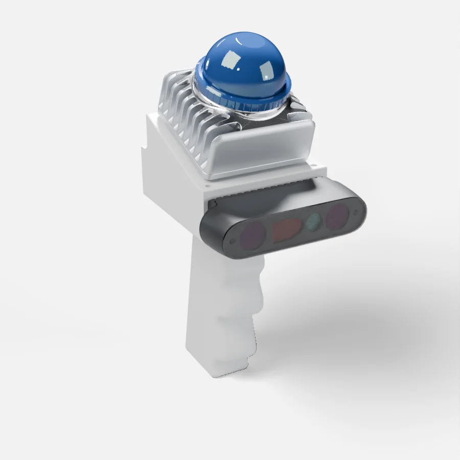
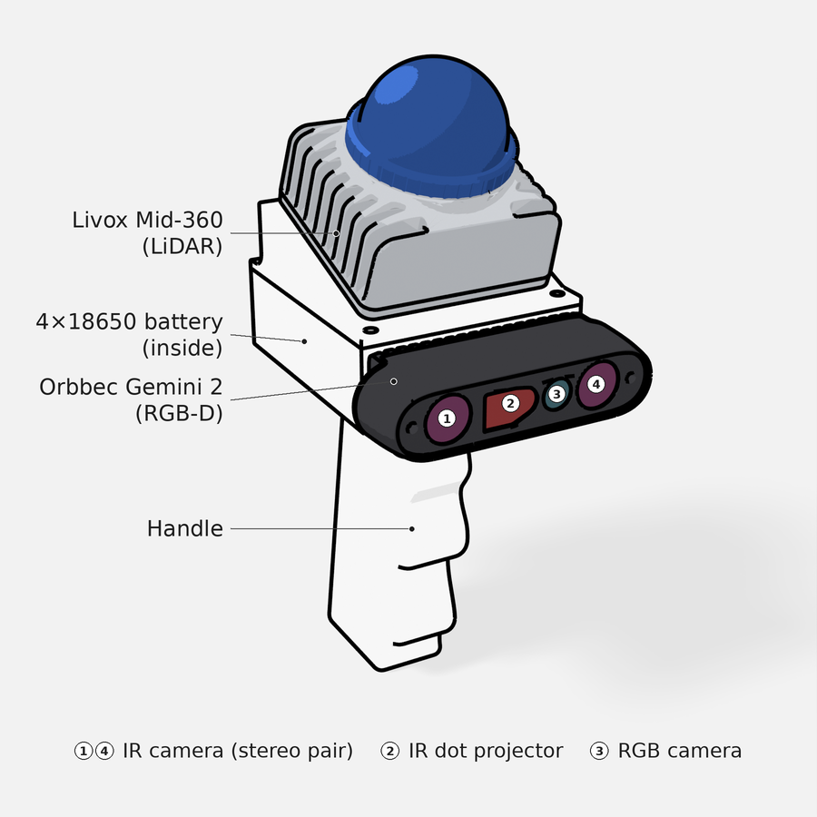
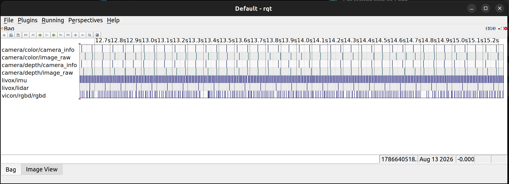

# RGBD Scanner

Record time-synced ROS 2 bags from Orbbec Gemini 2 + Livox Mid-360 + Vicon.

## The rig

<p align="center">
  <a href="hardware/rig_approx.stl"></a>
  
</p>

Click the animation to open the rotatable 3D model.

Approximate assembly of the printed parts in `hardware/print_file/`; the exact CAD is `hardware/3D_model/POSEDRGBD.SLDASM`. Rig designed by Ziqi Ma.

## Layout

```
rgbd_scanner/
├── hardware/                # CAD, print files and BOM of the rig
└── third_party/
    ├── ros2_ws/src/         # one colcon workspace with three drivers
    │   ├── OrbbecSDK_ROS2/      # Gemini 2
    │   ├── livox_ros_driver2/   # Mid-360
    │   └── ros2-vicon-bridge/   # Vicon
    └── Livox-SDK2/          # non-ROS SDK used by livox_ros_driver2
```

## Add a new driver

Clone it into `third_party/ros2_ws/src/`, rebuild `ros2_ws`, and keep the
same `source` line: `colcon build` compiles every package under `src/` into
`install/`, and `install/setup.bash` loads all of them at once.

```bash
cd third_party/ros2_ws/src
# example: FAST-LIO
git clone --recursive -b ROS2 https://github.com/hku-mars/FAST_LIO.git
# vendor it, otherwise git commits it as a submodule link
rm -rf FAST_LIO/.git
cd ..
colcon build --symlink-install \
  --cmake-args \
    -DROS_EDITION=ROS2 \
    -DDISTRO_ROS=humble \
    -DCMAKE_BUILD_TYPE=Release
cd ../..
```

A non-ROS SDK goes under `third_party/`, outside `ros2_ws`, and is installed
on its own (like `Livox-SDK2` in Step 0).

## Record a bag (Gemini 2 + Mid-360 + Vicon)

Run every command from the repo root (`cd rgbd_scanner` after cloning).

### Step 0 — Install the SDK, udev rules and drivers (once)

```bash
cd third_party/Livox-SDK2
mkdir -p build && cd build
cmake .. && make -j
sudo make install
cd ../../..
```

```bash
cd third_party/ros2_ws/src/OrbbecSDK_ROS2/orbbec_camera/scripts
sudo bash install_udev_rules.sh
cd -
```

```bash
# run `conda deactivate` first if conda is active
cd third_party/ros2_ws
source /opt/ros/humble/setup.bash
colcon build --symlink-install \
  --cmake-args \
    -DROS_EDITION=ROS2 \
    -DDISTRO_ROS=humble \
    -DCMAKE_BUILD_TYPE=Release
cd ../..
```

### Step 1 — Start the Gemini 2 and check color and depth at ~15 Hz

```bash
source third_party/ros2_ws/install/setup.bash
ros2 launch orbbec_camera gemini2.launch.py \
  time_domain:=system \
  enable_ir:=false \
  enable_point_cloud:=false \
  color_width:=1280 \
  color_height:=720 \
  color_fps:=15 \
  color_format:=YUYV \
  depth_width:=1280 \
  depth_height:=800 \
  depth_fps:=15 \
  depth_format:=Y16 \
  color_ae_max_exposure:=20000
```

hz on image_raw reads low for large frames, so check camera_info, which is
published with every frame.

```bash
source third_party/ros2_ws/install/setup.bash
ros2 topic hz /camera/color/camera_info  # ~15 Hz
ros2 topic hz /camera/depth/camera_info  # ~15 Hz
ros2 topic echo --once --no-arr /camera/color/image_raw  # prints one header
```

### Step 2 — Start the Mid-360 and check IMU at ~200 Hz and LiDAR at 10 Hz

```bash
# set the NIC wired to the Mid-360 to 192.168.123.200
source third_party/ros2_ws/install/setup.bash
ros2 launch livox_ros_driver2 msg_MID360_launch.py
```

```bash
source third_party/ros2_ws/install/setup.bash
ros2 topic hz /livox/imu    # ~200 Hz
ros2 topic hz /livox/lidar  # ~10 Hz
```

### Step 3 — Start the Vicon bridge and check the rig pose

[Update the Vicon IP here before every session](third_party/ros2_ws/src/ros2-vicon-bridge/launch/all_segments.launch.py#L6)

```bash
source third_party/ros2_ws/install/setup.bash
ros2 launch vicon_bridge all_segments.launch.py
```

```bash
source third_party/ros2_ws/install/setup.bash
ros2 topic hz /vicon/rgbd/rgbd           # ~80 Hz
ros2 topic echo --once /vicon/rgbd/rgbd  # prints one pose
```

### Step 4 — Record all 7 topics into a bag

```bash
source third_party/ros2_ws/install/setup.bash
ros2 bag record -s sqlite3 -o bags/rig_1031_2330 \
  /camera/color/image_raw \
  /camera/color/camera_info \
  /camera/depth/image_raw \
  /camera/depth/camera_info \
  /livox/lidar \
  /livox/imu \
  /vicon/rgbd/rgbd
```

```bash
source third_party/ros2_ws/install/setup.bash
ros2 bag info bags/rig_1031_2330
```

### Step 5 — Inspect the bag in rqt

```bash
source third_party/ros2_ws/install/setup.bash
rqt
```

In rqt: Plugins → Logging → Bag, then open the `bags/rig_1031_2330`
directory.



`color/image_raw` and `depth/image_raw` ticks should line up one-to-one
(timestamps aligned).

### Step 6 — Replay the bag and watch the color stream

```bash
source third_party/ros2_ws/install/setup.bash
ros2 bag play bags/rig_1031_2330  # add --loop to repeat
```

In rqt: Plugins → Visualization → Image View, then pick
`/camera/color/image_raw` to see the frames being replayed.
